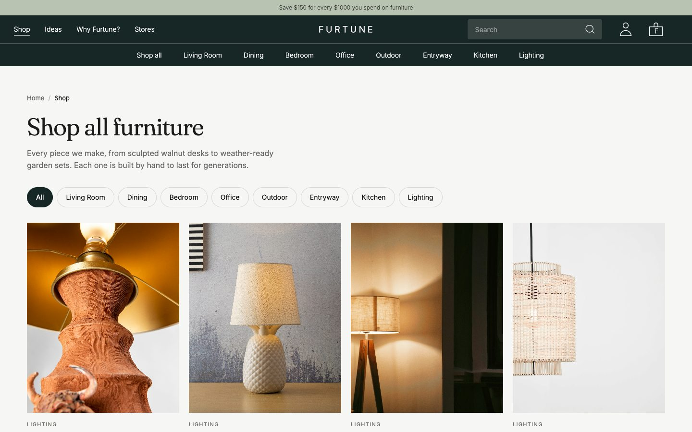
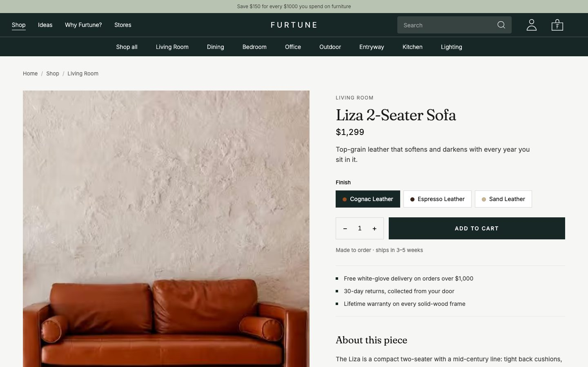
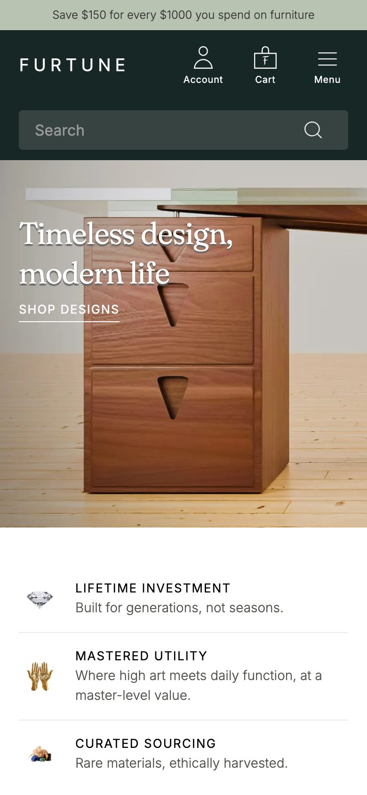
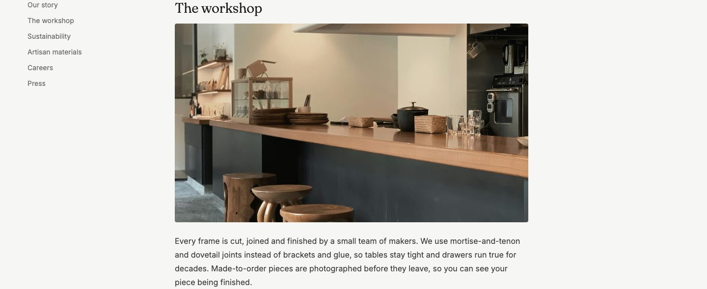

# Furtune

Furtune is an online furniture store, built as a portfolio project.

**Live site:** https://furtune.webflow.io

| Shop | Product page |
| --- | --- |
|  |  |

| On a phone | About page |
| --- | --- |
|  |  |

## How it's built

Most of the site is built in **Webflow**: the design, page layouts, product catalogue (CMS), animations and store pages. That part lives in Webflow, so it isn't in this repository.

This repository holds the **custom code** added on top of Webflow, for features Webflow doesn't provide on its own:

- **Real customer accounts** with Google sign-in and email/password, using Firebase Authentication.
- **The signed-in customer's photo** (or initial) in the header on every page.
- **Shop-page search** that filters the real catalogue.
- **A working cart and checkout flow**, with order totals, discounts and delivery rules.
- **A menu drawer**, plus layout fixes for tablet and phone.
- **Matching hover effects** on the homepage cards.
- **Speed work**: the main photo loads first, the video waits until it's needed, and expensive animations were made lighter.

## What's in each folder

| File | Where it runs | What it does |
| --- | --- | --- |
| `login/firebase-auth.js` | Sign-in page | Handles sign-in, account creation, Google sign-in, password reset and sign-out. Once someone is signed in, the page shows a welcome card. |
| `login/firebase-auth.css` | Sign-in page | Styles for the error messages and the signed-in welcome card. |
| `site-wide/account-avatar.js` | Every page | Swaps the header account icon for the signed-in customer's photo or initial. |
| `site-wide/account-avatar.css` | Every page | Makes that photo round, without changing its size or spacing. |
| `site-wide/cart-checkout-and-menu.js` | Every page | Runs the cart, the checkout, the menu drawer, the header links and the footer currency picker. |
| `site-wide/search-video-and-pricing.js` | Every page | Runs the Shop search, loads the homepage video only when needed, calculates order totals and the "You may also like" picks, and fixes some content. |
| `site-wide/menu-and-responsive.css` | Every page | Styles the menu drawer and the tablet and phone layouts (gutters, swipe rows, footer, checkout). |
| `site-wide/layout-and-motion-fixes.css` | Every page | Lighter scroll animations, header logo placement and search results styling. |
| `site-wide/hero-image-preload.js` | Every page (only acts on the homepage) | Starts loading the homepage's main photo as early as possible. |
| `homepage/card-hover-effects.css` | Homepage | Gives the room cards and product cards one matching hover. |

## How it's added to Webflow

Each file is pasted into Webflow inside `<script>` or `<style>` tags:

- **Site-wide files:** in Embed elements inside parts of the site that every page shares, such as the navbar.
- **Homepage files:** in an Embed element on the homepage.
- **Login files:** in an Embed element on the sign-in page. Load `firebase-auth.js` as `<script type="module">`.

**A note on the Firebase settings in `firebase-auth.js`:** the web config is public by design. Firebase only accepts sign-ins from the site's approved domain.

## Built with

Webflow · Firebase Authentication · plain JavaScript and CSS (no build step)
